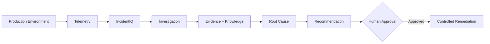

# IncidentIQ

IncidentIQ is an AI-assisted incident response and root-cause analysis platform for software engineering/SRE teams. It connects to a production-like environment, analyzes operational telemetry, investigates incidents, provides evidence-backed root-cause hypotheses, and recommends remediation with human approval.

## Problem

During incidents, engineers often need to investigate logs, metrics, traces, deployments, system state, and historical knowledge across different sources. IncidentIQ aims to bring these signals into one unified investigation workflow.

## How It Works

1. **Production Environment** generates operational telemetry.
2. **Telemetry** provides logs, metrics, traces, events, and system state.
3. **IncidentIQ** runs an investigation workflow using structured tools.
4. **Evidence + Historical Knowledge** are combined to investigate the incident.
5. **Root Cause Analysis** produces evidence-backed hypotheses.
6. **Recommendation** proposes a targeted remediation.
7. **Human Approval** is required before impactful changes.
8. **Controlled Remediation** executes predefined actions.

## Production Environment

A small Docker-based, production-like environment will simulate realistic operational scenarios:

* API services
* PostgreSQL
* Redis
* Background worker

The environment will support controlled failure injection so incidents can be reproduced and tested.

## Telemetry

**Live Telemetry**

* Logs
* Metrics
* Traces
* Alerts
* Deployments and configuration changes
* Database, queue, and system state

**Historical Knowledge**

* Runbooks
* Previous incidents
* Postmortems

## AI Role

* **LangGraph** coordinates the investigation workflow.
* **Tools** retrieve operational data.
* **RAG** retrieves relevant historical knowledge.
* **LLM** analyzes evidence, generates hypotheses, and recommends remediation.
* **Deterministic code** handles authorization, validation, and system operations.

## Safety

* **No arbitrary command execution:** The model cannot execute arbitrary shell commands.
* **Predefined actions:** Remediation is limited to explicit, validated operations.
* **Human approval:** Impactful actions require operator approval.
* **Audit trail:** Investigation findings, decisions, and actions are recorded.

## Tech Stack

| Layer              | Planned Technologies                     |
| ------------------ | ---------------------------------------- |
| **Frontend**       | Next.js, React, TypeScript, Tailwind CSS |
| **Backend**        | Python, FastAPI, PostgreSQL              |
| **AI**             | LangGraph, LLM API, RAG                  |
| **Infrastructure** | Docker, Docker Compose                   |
| **Observability**  | Prometheus, OpenTelemetry                |

## Roadmap

* [ ] Architecture & feasibility
* [ ] Production simulator
* [ ] Telemetry
* [ ] IncidentIQ backend
* [ ] Investigation workflow
* [ ] RAG + RCA
* [ ] Human approval/remediation
* [ ] Frontend
* [ ] Evaluation

## Current Status

**Architecture & feasibility planning**

The repository is currently in the early design and planning stage. Implementation will follow the roadmap above.

## Future

Potential future integrations:

* Cloud monitoring
* Slack / ChatOps
* GitHub deployment context
* Kubernetes
