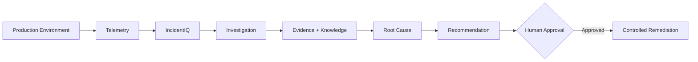

# IncidentIQ

IncidentIQ is an AI-assisted incident response and root-cause analysis platform for software engineering/SRE teams. It connects to a production-like environment, analyzes operational telemetry, investigates incidents, provides evidence-backed root-cause hypotheses, and recommends remediation with human approval.

## Problem

During incidents, engineers often need to investigate logs, metrics, traces, deployments, system state, and historical knowledge across different sources. IncidentIQ aims to bring these signals into one unified investigation workflow.

## How It Works



1. **Production Environment** generates operational telemetry.
2. **Telemetry** provides logs, metrics, traces, events, and system state.
3. **IncidentIQ** runs an investigation workflow using structured tools.
4. **Evidence + Historical Knowledge** are combined to investigate the incident.
5. **Root Cause Analysis** produces evidence-backed hypotheses.
6. **Recommendation** proposes a targeted remediation.
7. **Human Approval** is required before impactful changes.
8. **Controlled Remediation** executes predefined actions.

## Architecture

| Component | Technology | Location |
|---|---|---|
| Frontend | React + Vite + JavaScript + Tailwind CSS | `frontend/` |
| Backend | Python 3.11+, FastAPI, Pydantic, SQLAlchemy, Alembic | `backend/` |
| Database | PostgreSQL | `db` (Docker Compose) |
| AI | Gemini API (`google-genai`), validated structured output | Backend only |
| Simulator | Python + FastAPI production simulator | `simulator/` |
| Infrastructure | Docker Compose | `docker-compose.yml` |

The backend is a modular monolith. The frontend, backend and simulator are
independent services that talk over HTTP/JSON only.

See `docs/architecture.md` for the module boundaries and the investigation
pipeline, `docs/api-contract.md` for the canonical HTTP contract and
`docs/data-model.md` for the domain model.

## LLM integration

- Provider: **Gemini API** through the official `google-genai` SDK, used by the
  backend only. The API key never reaches the browser.
- Model: `gemini-3.8-flash` by default, overridable with `GEMINI_MODEL`.
- Structured output: JSON schema constrained output, validated with Pydantic.
- Evidence safety: every evidence id returned by the model is verified against
  the evidence actually collected for the incident. Unknown ids are removed and
  hypotheses without supporting evidence are discarded.
- Confidence is a self-reported **estimate**, not a calibrated probability.
- **Deterministic fallback:** the backend works with no API key and falls back
  to a rule-based analysis engine when the provider times out, is rate limited,
  returns malformed output or is unavailable.

## Safety

* **No arbitrary command execution:** the model cannot execute shell commands.
* **Predefined actions:** remediation is limited to an explicit, validated
  allowlist (`backend/app/remediation/allowlist.py`).
* **Human approval:** impactful actions require an explicit approval call that
  carries the operator identity.
* **Audit trail:** investigation findings, decisions and actions are recorded.
* **No fabricated evidence:** the backend never invents evidence or evidence ids.

## Quick start

```bash
cp .env.example .env          # optional: add GEMINI_API_KEY to enable the LLM
docker compose up --build
```

| Service | URL |
|---|---|
| Frontend | http://localhost:5173 |
| Backend API | http://localhost:8000/api/v1 |
| Backend docs | http://localhost:8000/docs |
| Simulator | http://localhost:8001 |
| PostgreSQL | localhost:5432 |

The backend runs `alembic upgrade head` on start and stays healthy without a
Gemini API key.

### Run the backend locally without Docker

```bash
cd backend
python -m venv .venv && .venv\Scripts\activate   # or: uv venv --python 3.12 .venv
pip install -r requirements.txt
alembic upgrade head
uvicorn app.main:app --reload --port 8000
```

Set `DATABASE_URL` to a PostgreSQL URL, or to `sqlite:///./incidentiq.db` for
local development.

### Tests

```bash
cd backend
python -m pytest -q
```

## API overview

| Method | Path | Purpose |
|---|---|---|
| `GET` | `/health` | Service health and dependency status. |
| `GET` | `/api/v1/incidents` | List incidents. |
| `POST` | `/api/v1/incidents` | Create an incident. |
| `GET` | `/api/v1/incidents/{id}` | Get an incident. |
| `POST` | `/api/v1/incidents/{id}/evidence` | Collect and persist evidence. |
| `GET` | `/api/v1/incidents/{id}/evidence` | List stored evidence. |
| `POST` | `/api/v1/incidents/{id}/investigate` | Run the investigation pipeline. |
| `GET` | `/api/v1/incidents/{id}/investigations` | List investigation reports. |
| `GET` | `/api/v1/incidents/{id}/investigations/{inv_id}` | Get one report. |
| `POST` | `/api/v1/incidents/{id}/remediations` | Create a remediation proposal. |
| `GET` | `/api/v1/incidents/{id}/remediations` | List remediations. |
| `POST` | `/api/v1/remediations/{id}/approve` | Approve and execute (requires `X-Operator-Id`). |
| `POST` | `/api/v1/remediations/{id}/reject` | Reject (requires `X-Operator-Id`). |
| `POST` | `/api/v1/remediations/{id}/execute` | Execute an already approved remediation. |

Full request and response schemas are in `docs/api-contract.md`.

## Configuration

| Variable | Component | Default | Purpose |
|---|---|---|---|
| `DATABASE_URL` | backend | `postgresql+psycopg://incidentiq:incidentiq@db:5432/incidentiq` | Database URL. |
| `SIMULATOR_BASE_URL` | backend | `http://simulator:8001` | Simulator service URL. |
| `GEMINI_API_KEY` | backend | unset | Gemini API key. Optional. |
| `GEMINI_MODEL` | backend | `gemini-3.8-flash` | Gemini model id. |
| `LLM_ENABLED` | backend | `true` | Master switch for provider calls. |
| `LLM_TIMEOUT_SECONDS` | backend | `45` | Provider timeout. |
| `API_KEY` | backend | unset | When set, `X-API-Key` is required on `/api/v1/**`. |
| `CORS_ORIGINS` | backend | `http://localhost:5173` | Allowed browser origins. |
| `VITE_API_BASE_URL` | frontend | `http://localhost:8000` | Backend URL used by the browser. The frontend appends `/api/v1/...` itself. |

Never commit `.env` files or credentials.

## Roadmap

* [x] Architecture & feasibility
* [ ] Production simulator
* [ ] Telemetry
* [x] IncidentIQ backend
* [x] Investigation workflow
* [ ] RAG + RCA (historical knowledge retrieval)
* [x] Human approval/remediation
* [ ] Frontend
* [ ] Evaluation

## Future

* Cloud monitoring
* Slack / ChatOps
* GitHub deployment context
* Kubernetes
