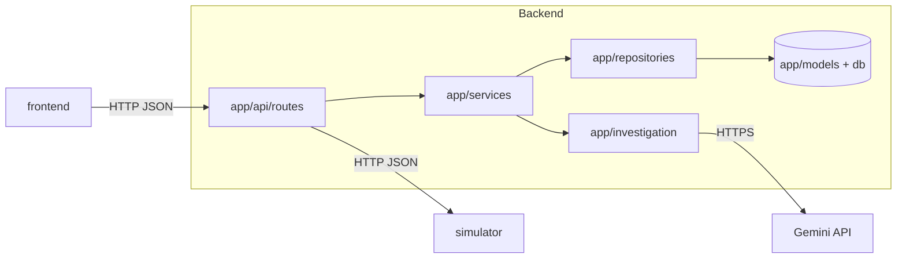

# IncidentIQ Architecture

Version: v1.2
Owner: Agent 3 (backend + coordination)

## 1. Purpose
IncidentIQ investigates simulated production incidents using telemetry,
historical knowledge, and AI-generated root-cause hypotheses.

The system recommends fixes and requires human approval before remediation.

## 2. Architecture
- Frontend: React + Vite + JavaScript + Tailwind CSS
- Backend: Python + FastAPI + Pydantic
- Database: PostgreSQL + SQLAlchemy + Alembic
- AI: Gemini API with validated structured outputs, behind a provider interface
- Simulator: Independent Python + FastAPI application
- Infrastructure: Docker Compose
- Testing: pytest and frontend tests
- Deployment target: Render

The backend is a modular monolith. It is not split into microservices. The
module boundaries are:



| Module | Responsibility |
|---|---|
| `app/api` | Thin HTTP routes, request validation, error mapping. |
| `app/services` | Use cases: incident lifecycle, evidence, remediation. |
| `app/investigation` | Investigation pipeline, LLM provider, deterministic fallback. |
| `app/repositories` | All database access. |
| `app/models` | SQLAlchemy ORM models. |
| `app/schemas` | Pydantic request and response models. |
| `app/core` | Configuration, logging, errors, identifiers. |

## 3. Components

### Frontend
Displays incidents, evidence timelines, RCA reports, and remediation approval.
Calls the backend using the shared API contract.

### Backend
A modular monolith responsible for:
- Incident lifecycle and validation
- Evidence ingestion and investigation
- RCA orchestration and AI integration
- Database persistence
- Remediation authorization and audit records

### Production Simulator
An independent application that simulates a payment service.
Generates controlled failures, structured logs, metrics, and deployment events.

### Database
PostgreSQL stores incidents, evidence, RCA reports, and audit history.
Only the backend owns application database writes.

## 4. Incident flow
1. A user triggers a simulator failure.
2. The simulator records the failure and associated telemetry.
3. The backend collects evidence and creates an incident.
4. The investigation engine correlates evidence and generates RCA hypotheses.
5. The dashboard displays the report and supporting evidence.
6. An authorized user approves or rejects a proposed action.
7. The backend validates and executes an allowlisted simulated action.
8. The outcome is recorded and service health is checked again.

## 5. Engineering principles
- Keep components independently runnable.
- Use clear service, repository, schema, and API boundaries.
- Use dependency injection for replaceable implementations.
- Keep configuration and secrets out of source code.
- Use structured logging and consistent error responses.
- Provide deterministic RCA when the LLM is unavailable.
- Never execute real production remediation.
- Test failures and recovery, not just successful requests.

## 6. Service configuration

| Variable | Component | Default | Purpose |
|---|---|---|---|
| `DATABASE_URL` | backend | `postgresql+psycopg://incidentiq:incidentiq@db:5432/incidentiq` | SQLAlchemy database URL. |
| `SIMULATOR_BASE_URL` | backend | `http://simulator:8001` | Base URL of the simulator service. |
| `GEMINI_API_KEY` | backend | unset | Gemini API key. The backend must start and stay healthy without it. |
| `GEMINI_MODEL` | backend | `gemini-3.8-flash` | Gemini model id used for investigation. |
| `LLM_ENABLED` | backend | `true` | Master switch for provider calls. |
| `LLM_TIMEOUT_SECONDS` | backend | `45` | Per-request provider timeout. |
| `API_KEY` | backend | unset | When set, `X-API-Key` is required on `/api/v1/**`. |
| `CORS_ORIGINS` | backend | `http://localhost:5173` | Comma-separated allowed origins. |
| `LOG_LEVEL` | backend | `INFO` | Structured log level. |
| `VITE_API_BASE_URL` | frontend | `http://localhost:8000` | Backend base URL used by the frontend API client. The frontend appends `/api/v1/...` itself. |

- The frontend never receives `GEMINI_API_KEY` or any other credential.
- Use `.env.example` to document required configuration.
- Never commit `.env` files containing secrets.

## 7. LLM integration

- Provider: **Gemini API** via the official `google-genai` Python SDK.
- Model: `gemini-3.8-flash` (stable, structured-output capable), overridable
  with `GEMINI_MODEL`.
- Structured output: `response_mime_type: "application/json"` together with
  `response_json_schema` derived from the Pydantic RCA model. The schema is
  flattened so it contains no `$ref`/`$defs`, because Gemini supports only a
  subset of JSON Schema.
- Access is exclusive to the backend. The frontend never calls Gemini.
- The provider interface (`app/investigation/llm/base.py`) returns a validated
  `RCAReport` or raises a typed error. The pipeline catches every error and
  falls back to the deterministic engine.

### 7.1 Investigation pipeline

```mermaid
flowchart TD
    A[POST /incidents/{id}/investigate] --> B[Set status investigating]
    B --> C[Collect evidence from simulator]
    C --> D[Persist evidence with fingerprint dedupe]
    D --> E{API key present and LLM enabled?}
    E -->|yes| F[Gemini structured output]
    E -->|no| H[Deterministic engine]
    F --> G{Output valid and evidence IDs verified?}
    G -->|yes| I[Persist hypotheses]
    G -->|no| H
    H --> I
    I --> J[Create remediation proposals pending_approval]
    J --> K[Set incident status]
```

The pipeline is a single, linear function. LangGraph and multi-agent
orchestration are not used in the MVP because they add no value at this
complexity level.

### 7.2 Evidence safety rules

1. Evidence is collected and filtered before it is sent to the provider.
   Only the fields required for analysis are transmitted.
2. The provider is instructed to cite only evidence identifiers from the
   supplied list.
3. Every returned identifier is checked against the evidence collected for the
   same incident. Unknown identifiers are stripped; hypotheses left without
   valid evidence are discarded and reported as warnings.
4. Free-text mentions of unknown identifiers cause the hypothesis to be
   discarded.
5. The provider never fabricates evidence. A hypothesis without supporting
   evidence is not persisted.
6. Model confidence is stored and shown as an estimate, not as a calibrated
   probability.

### 7.3 Provider failure handling

| Failure | Behaviour |
|---|---|
| Missing API key | Deterministic fallback, `llm_used: false`. |
| Timeout | Deterministic fallback, warning recorded. |
| Rate limit (HTTP 429) | Deterministic fallback, warning recorded. |
| Malformed output | Deterministic fallback, warning recorded. |
| Provider error (5xx / transport) | Deterministic fallback, warning recorded. |

The fallback engine applies fixed rules over the collected evidence and
produces the same report structure, so the demo always works without
credentials.

## 8. Safe remediation

- The provider may only *propose* an action from the server-side allowlist.
- Proposals are created in status `pending_approval` and are never executed by
  the investigation endpoint.
- Execution requires an explicit approval call that carries the operator
  identity header `X-Operator-Id`.
- The allowlist is enforced server-side. Unknown actions and unknown or
  invalid parameters are rejected with `422`.
- The dispatcher calls the simulator's `/internal/remediations` endpoint. It
  never runs shell commands and never reaches outside the demo environment.
- Approval, rejection, execution outcome and timestamps are recorded in the
  remediation row and in the audit log.

## 9. Docker Compose services

| Service | Image build | Port (host) | Purpose |
|---|---|---|---|
| `db` | `postgres:16-alpine` | 5432 | PostgreSQL. |
| `backend` | `backend/Dockerfile` | 8000 | FastAPI application. |
| `simulator` | `simulator/Dockerfile` | 8001 | FastAPI production simulator. |
| `frontend` | `frontend/Dockerfile` | 5173 | Vite dev server. |

Container names are `incidentiq-db`, `incidentiq-backend`,
`incidentiq-simulator`, `incidentiq-frontend`.

The backend waits for `db` to become healthy and runs Alembic migrations
before serving.
