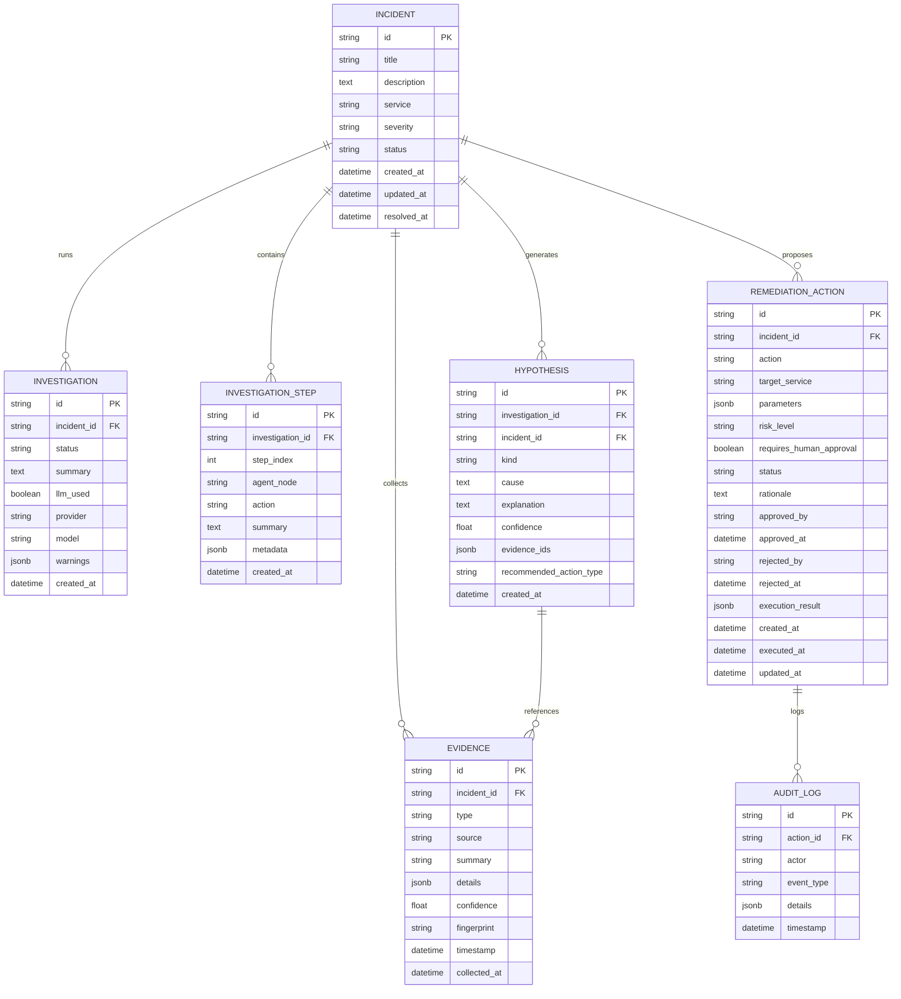
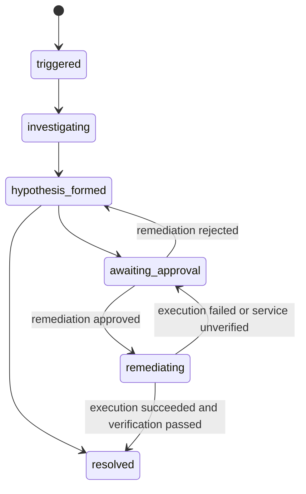

# IncidentIQ Data Model Specification

Version: v1.2
Owner: Agent 3 (backend + coordination)

This document defines the domain models, database schema, enum states and
relationship mappings for **IncidentIQ**. It is aligned with
`docs/api-contract.md` v1.2. Enum values are lowercase snake_case on the wire
and in the database.

Database: PostgreSQL in production and Docker Compose, SQLite is supported for
local development and automated tests. Only the backend writes to this
database.

---

## 1. Entity Relationship Diagram

---

## 2. Enums

### `IncidentStatus`

| Value | Meaning |
|---|---|
| `triggered` | Incident created, awaiting analysis. |
| `investigating` | Telemetry and evidence collection in progress. |
| `hypothesis_formed` | RCA hypotheses generated by the deterministic engine or the LLM. |
| `awaiting_approval` | A remediation proposal exists and awaits human authorization. |
| `remediating` | Approved action dispatched to the simulator. |
| `resolved` | Service recovered and validated healthy. |

Transitions:

### `SeverityLevel`

| Value | Meaning |
|---|---|
| `critical` | Outage, core checkout/payment failure, data corruption risk. |
| `high` | Significant latency or degraded throughput on a critical path. |
| `medium` | Partial degradation, background job delays. |
| `low` | Minor performance anomalies, warnings. |

### `EvidenceType`

| Value | Meaning |
|---|---|
| `log` | Application or container log entries with stack trace/error. |
| `metric` | Time-series anomaly (latency, error rate, CPU, connection saturation). |
| `deployment` | Recent release, configuration change or rollout event. |
| `state` | Current health probe or container state. |
| `event` | Alerts and domain events. |
| `trace` | Distributed trace spans. |

### `RemediationStatus`

| Value | Meaning |
|---|---|
| `pending_approval` | Awaiting human operator sign-off. |
| `approved` | Authorized for execution. |
| `rejected` | Disapproved by an operator. |
| `executing` | Dispatched to the simulator. |
| `success` | Verified healthy after application. |
| `failed` | Execution failed or the service remained degraded. |

### `HypothesisKind`

| Value | Meaning |
|---|---|
| `root_cause` | Primary candidate cause. |
| `alternative` | Secondary candidate cause. |

---

## 3. Entity rules

### 3.1 Incident

- `id` is generated by the backend with the `inc_` prefix.
- `severity` and `status` use the enums above.
- `resolved_at` is set when the incident reaches `resolved`.
- `updated_at` is maintained by the ORM on every write.

### 3.2 Evidence

- `id` is generated by the backend with the `ev_` prefix. Simulator identifiers
  are not reused.
- `fingerprint` is a SHA-256 hex digest over the normalised
  `(type, source, timestamp, summary)` tuple. A unique constraint on
  `(incident_id, fingerprint)` prevents duplicate evidence when an incident is
  investigated repeatedly.
- `confidence` is the relevance estimate assigned by the collection pipeline,
  between `0` and `1`. It is an estimate, not a calibrated probability.
- `details` holds the raw provider payload as JSON.

### 3.3 Investigation

- One row per investigation run. `provider` is `gemini` or `deterministic`.
- `model` is the Gemini model id used, or `null` for the deterministic engine.
- `warnings` records non-fatal problems such as an unreachable simulator, a
  provider error, or discarded hypotheses with unverifiable evidence IDs.
- `INVESTIGATION_STEP` rows record the ordered pipeline steps
  (`agent_node`, `action`, `summary`, `metadata`).

### 3.4 Hypothesis

- `evidence_ids` is a JSON array of `ev_` identifiers.
- Every identifier is verified against the evidence collected for the same
  incident before the hypothesis is persisted.
- `confidence` is the provider-reported estimate between `0` and `1`.
- `recommended_action_type` is either `null` or an action from the
  remediation allowlist.

### 3.5 Remediation action

- `action` must be on the server-side allowlist:

  | Action | Required parameters | Optional parameters | Risk |
  |---|---|---|---|
  | `rollback_demo_deployment` | none | `version` | medium |
  | `restart_demo_service` | none | none | medium |
  | `scale_demo_instances` | `instances` (int 1..10) | none | low |
  | `clear_demo_cache` | none | none | low |

- `requires_human_approval` is always `true` in the MVP.
- `approved_by` stores the `X-Operator-Id` value. `approved_at`,
  `rejected_by`, `rejected_at` and `executed_at` record the lifecycle.
- `execution_result` stores the simulator response and the outcome:
  `{"outcome": "success" | "failed", "message": "...", "details": {...},
  "service_healthy": bool, "service_health_status": "ok" | "degraded" |
  "unreachable", "verification_passed": bool}`. The incident is only resolved
  when `verification_passed` is `true`.
- A row in `AUDIT_LOG` is written for every lifecycle event
  (`created`, `approved`, `rejected`, `execution_started`, `execution_succeeded`,
  `execution_failed`).

---

## 4. Storage rules

- All timestamps are stored as timezone-aware UTC (`timestamptz`).
- JSON columns use the native `jsonb` type on PostgreSQL and JSON text on
  SQLite.
- Foreign keys cascade on delete for evidence, hypotheses, investigations,
  steps and audit rows.
- The frontend and the simulator never write to this database. The backend is
  the only writer.
